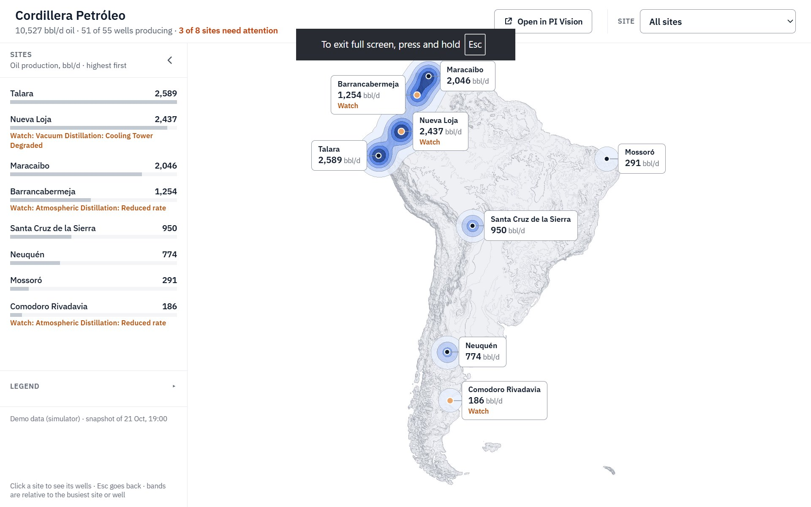
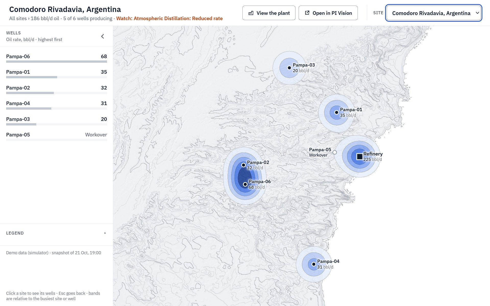
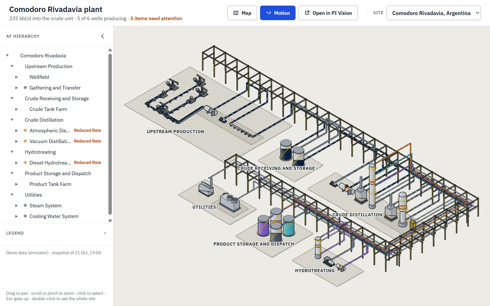
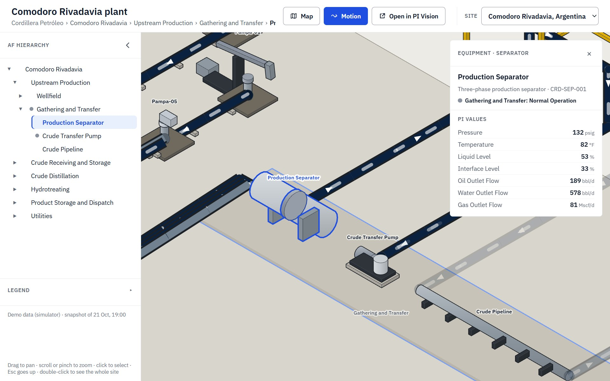
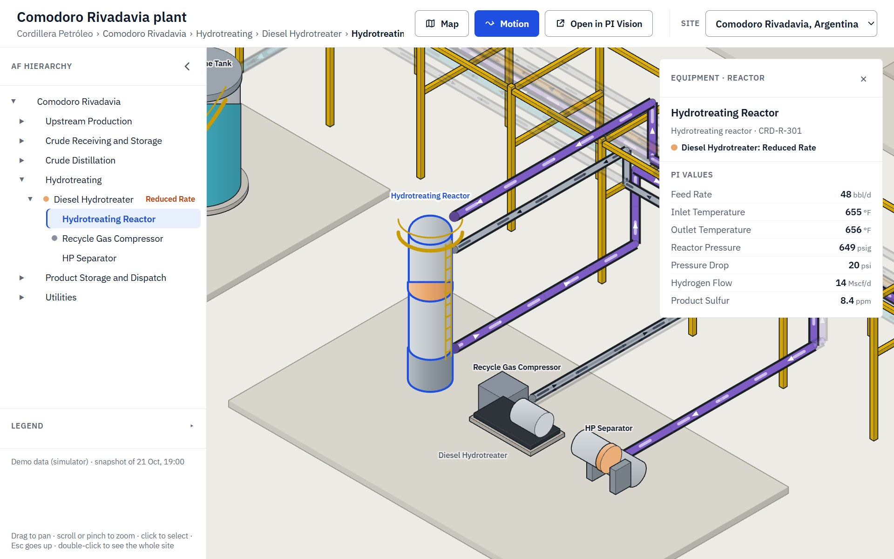
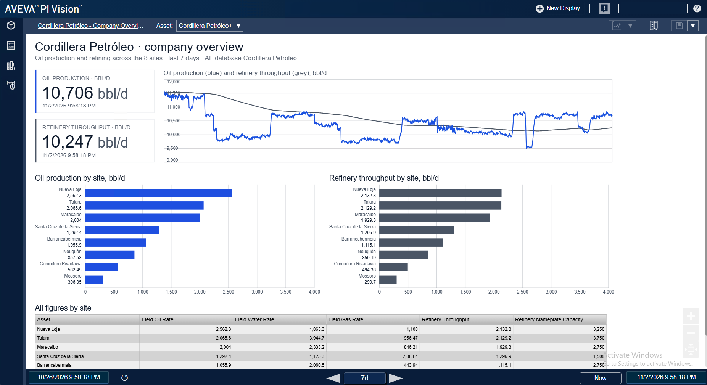
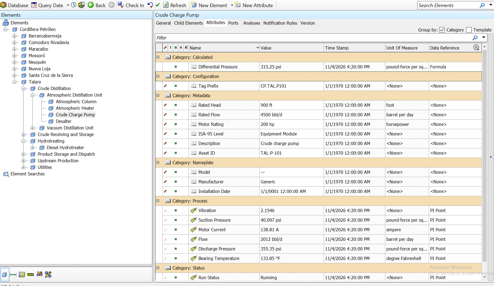

# Cordillera Petróleo: PI AF demo model and process simulator

A fictional oil & gas company with 8 sites in South America. Each site has a
wellfield (4–10 wells) and its own small refinery. The model follows
ISA-95 (Enterprise › Site › Area › Work Center › Work Unit, 5 levels max), and the ISA-88
physical model names the refinery units.

| | |
|---|---|
| Sites / wells | 8 / 55 |
| AF elements | 352 |
| Element templates | 29 + 1 event frame template |
| PI points | 2,347 (2,305 written by the simulator, 42 by rollup analyses) |
| Analyses | 1 event frame generation (Well) + 6 rollup templates, 97 instances |
| Notification rule | 1 rule template on each of the 5 lift templates (55 instances) |

Model review page: `docs/af-model.html` (open in a browser).

## What it looks like

**Operations map** (`dashboard/topo.html`). All 8 sites on a contour map, oil production drawn as
colored bands, sites that need attention flagged in orange:



Click a site to zoom to its wellfield, with each well's oil rate and status (here a well in workover):



**Plant view** (`dashboard/plant.html`). An isometric drawing of the site built from the AF hierarchy,
with product flowing along the pipes from the wells to the product tanks:



Select any element in the drawing or in the AF tree to see its live PI values:





**PI Vision.** Company overview display reading the same AF database: totals, 7-day trend,
production and refinery throughput by site:



**PI System Explorer.** The imported AF database, ISA-95 hierarchy on the left, attributes grouped
by category (configuration, metadata, nameplate, process, status) on the right:



## Repository layout

```
model/spec.py                 single source of truth: templates, sites, wells, equipment, analyses
model/model.json              generated from spec.py
af/build_af_xml.py            builds the AF XML import files from model.json
af/CordilleraPetroleo.xml     full import (templates, elements, analyses, notification rules)
af/CordilleraPetroleo_NoAnalytics.xml   fallback import without analyses/notifications
sim/                          simulator + PI Web API writer
dashboard/                    map of all sites and plant view per site for management, read AF via PI Web API
docs/                         model review page
```

Rebuild everything after editing `model/spec.py`:

```
python model/spec.py
python af/build_af_xml.py
python af/build_af_xml.py --no-analytics
python docs/build_page.py
```

## Naming

- Element names are human names: `Garzas-01`, `Crude Charge Pump`, `Atmospheric Distillation Unit`.
- The asset ID is in the `Asset ID` attribute: `BAR-W01`, `BAR-P-101`.
- PI tags are built from the ID: `CP.<SITE>.<ASSET>.<SUFFIX>`, e.g. `CP.BAR.W01.THP`, `CP.BAR.P101.FLOW`.
  Each element stores its prefix in `Tag Prefix`. Template config strings use `%@Tag Prefix%`,
  and each element in the XML also carries its resolved tag name.
- The PI server comes from the `PI Server` attribute on the top element *Cordillera Petróleo*
  (`PISERVER`). Every config string starts with `\\%@\Cordillera Petróleo|PI Server%\`,
  so pointing the whole database at another server is a one-value change.
- Points use point source `L` (Lab) with `compressing=0`, so every simulated value is kept.
- Status attributes are Int32 PI points read through AF enumeration sets (Well Status, Unit Status…).
  No PI digital state sets are needed.

## 1. Import the AF database

1. In PI System Explorer create an empty database named **Cordillera Petroleo**.
2. File › Import from File › `af/CordilleraPetroleo.xml`. Tick **Allow Create** and **Allow Update**.
3. If the import fails on analyses or notification rules, delete the database, import
   `af/CordilleraPetroleo_NoAnalytics.xml` instead, and create the analyses by hand (see section 5).

## 2. Create the PI points

The PI Point data references already contain the point settings
(`pointtype`, `pointsource=L`, `compressing=0`, `engunits`).

1. In PI System Explorer go to **Elements**, open the search (or select the root element
   *Cordillera Petróleo* and all descendants).
2. Select all elements › right-click › **Create or Update Data Reference**.
3. Check: `python -m sim check` should report 2,347 found, 0 missing.

## 3. Configure and test the simulator

Requirements: Python 3.11+ on a machine that can reach PI Web API.

```
pip install requests requests-negotiate-sspi     # Windows, Kerberos with the logged-on user
# or: pip install requests requests-kerberos     # Linux Kerberos
# or: pip install requests requests-ntlm         # NTLM
copy sim\config.example.toml sim\config.toml     # then edit url, data_server, auth
```

**Password (only for `auth = "basic"` or `"ntlm"`).** The simulator reads it from the environment
variable named by `password_env` (default `PIWEBAPI_PASSWORD`), never from the file. To set it once
for your Windows user, so every new terminal and scheduled task run as you has it:

```
setx PIWEBAPI_PASSWORD "your-password"
```

Then **open a new terminal** (setx doesn't change the one you're in) and check with
`echo $env:PIWEBAPI_PASSWORD` (PowerShell). For a service or a task that runs as another account, set it
for that account, or machine-wide from an admin prompt: `setx PIWEBAPI_PASSWORD "your-password" /M`.
With `auth = "kerberos"` no password is needed: the simulator uses the Windows login it runs under.
The web dashboard never uses this variable; see `dashboard/README.md`.

The account needs write access to the `CP.*` points. PI Web API writes need
`X-Requested-With` (the client sends it) and the PI Web API instance must not be read-only.

Offline test, no PI needed: `python -m sim preview --days 7 --site BAR --out out`
writes a CSV you can open in Excel or pandas.

## 4. Backfill history, then run live

```
python -m sim check        # connectivity + missing points
python -m sim backfill     # from [simulation].start to now, 5-min steps (~90 days, ~60 M values)
python -m sim run          # replays history in memory without writing, then writes every 60 s
```

`start` in `config.toml` must stay fixed. The simulator is deterministic from that point,
so a restart rebuilds the same plant state before it continues. To fill a gap after downtime:
`python -m sim backfill --from 2026-10-20T08:00:00Z`.

### Backfill the analyses

Rollups and event frames are only calculated live. After the data backfill:
PI System Explorer › Management › select all analyses of *Cordillera Petroleo* ›
**Backfill/Recalculate** from the `start` date to now. Event frames for every Extraction Run
and the rollup totals then appear for the whole history.

## 5. Analyses (for manual creation if needed)

| Template | Analysis | Configuration |
|---|---|---|
| Well | Extraction Run Detection | Event Frame Generation, EF template *Extraction Run*, start trigger `'Well Status' = "Producing" And 'Oil Rate' > 5`, natural scheduling |
| Wellfield | Rollup Total Oil / Water / Gas Rate | Rollup, Sum of child `Oil Rate` / `Water Rate` / `Gas Rate` → `Total … Rate` |
| Storage Zone | Rollup Total Inventory | Rollup, Sum of child `Inventory` → `Total Inventory` |
| Enterprise | Rollup Total Oil Production | Rollup, Sum of child `Field Oil Rate` → `Total Oil Production` |
| Enterprise | Rollup Total Refinery Throughput | Rollup, Sum of child `Refinery Throughput` → `Total Refinery Throughput` |

Notification rule template *Extraction Run Notification* on each lift template (**Well - ESP**,
**Well - Rod Pump**, **Well - Gas Lift**, **Well - PCP**, **Well - Natural Flow**). AF does not inherit
notification rule templates from a base template; the rule's target must be the element's own template.
Criteria
`AnalysisName:"Extraction Run Detection"`. Add subscribers after import and choose
"notify on start" and/or "end" per subscriber.

## What the simulator does

Each well follows Arps decline with its own water cut and GOR. A per-well scenario timeline
drives planned shut-ins, workovers, gas interference, sand production, ESP pump wear and
rod-pump fluid pound. Water breakthrough hits about a third of the wells, and site-wide power
outages trip all artificially lifted wells. The `Sim Scenario` tag on wells, process units and
utility systems records the active scenario, so you can use it as a label for ML training.

The refinery is mass-balanced. Well production goes to the separator, transfer pump and pipeline,
then into two crude tanks that swap receiving and feeding duty. CDU feed follows crude inventory.
Column draws go to the product tanks, which are emptied by daytime dispatch. Diesel is hydrotreated.
Refinery scenarios: heater fouling (weeks-long rise in tube metal temperature), vacuum loss
(motive steam drop), cooling tower degradation, and recycle compressor trips (vibration rises in
the 6 h before the trip).

Coupled chains you can use for forecasting:

- Ambient wet bulb → cooling tower supply → ejector condenser outlet → vacuum column top pressure
- Boiler steam pressure → ejector motive steam → vacuum column top pressure
- Crude tank inventory → CDU feed → column draws → product tank levels

Units missing from the default AF UOM database (Mscf/d, lb/h, spm, °API, mil, PTB) are
kept in the PI point `engunits` and the attribute description, not as AF UOMs.

## Operations map

`dashboard/` holds full-screen landing maps for managers. The main one is `topo.html`: a paper contour
map with oil production drawn live as colored contour bands. Hover a site, well or refinery for its
key figures; click a site to zoom to its wellfield. Trends and tables are meant for PI Vision.
It reads AF through PI Web API and falls back to bundled demo data when PI Web API can't be reached.
`plant.html` is an isometric drawing of each site built from the AF hierarchy, with live product flows
from the wells to the product tanks.
Setup (hosting, CORS, authentication): `dashboard/README.md`.
